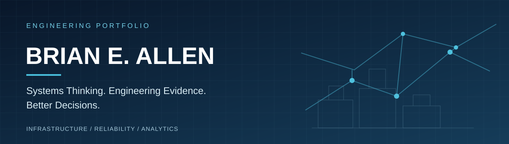
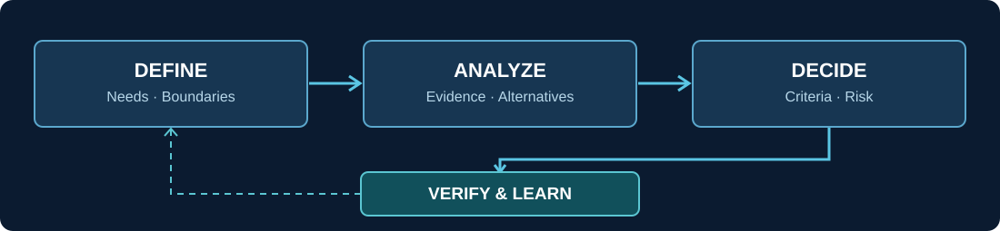
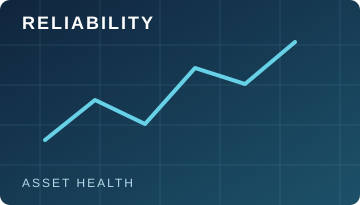
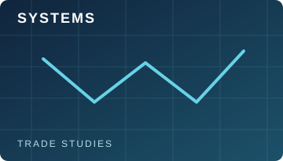
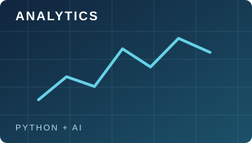

### Systems Engineering · Infrastructure Reliability · Asset Management · Python & AI

**Turning operational evidence into informed engineering decisions.**

## Engineering applied to operational challenges

I bring extensive experience leading facilities maintenance, infrastructure operations, and multidisciplinary technical teams in public-sector and institutional environments. My work connects asset performance, reliability, operational constraints, financial stewardship, and the decisions needed to sustain critical systems.

I am expanding that experience through **Systems Engineering methods**, **Python-based analysis**, and **AI-assisted information review**. My emphasis is on understanding the system before selecting a solution, documenting the evidence behind recommendations, and verifying outcomes.

## How I approach a problem

- **Define the system:** Identify stakeholders, operational needs, boundaries, interfaces, requirements, and constraints.
- **Examine the evidence:** Review field observations, equipment data, inspection records, and technical assumptions.
- **Evaluate alternatives:** Compare reliability, risk, lifecycle implications, cost, and implementation constraints.
- **Support the decision:** Make trade-offs and uncertainty visible to the people accountable for the outcome.
- **Verify and learn:** Confirm that implemented actions meet requirements and address the original need.

## Technical focus

<table>
<tr>
<td width="33%" valign="top"> <b>Infrastructure reliability</b> Condition assessment · Maintenance performance · Failure analysis · Asset lifecycle planning</td>
<td width="33%" valign="top"> <b>Systems engineering</b> System definition · Requirements · Interfaces · Trade studies · Verification</td>
<td width="33%" valign="top"> <b>Python, data & AI</b> Deterministic calculations · Data visualization · Workflow automation · LLM-assisted document analysis</td>
</tr>
</table>

## Portfolio development

I am building reproducible examples that apply engineering methods to real infrastructure and operations questions. Projects will use **synthetic or appropriately authorized data** and will document assumptions, calculation methods, limitations, and verification evidence.

| Project area | Intended demonstration |
| :--- | :--- |
| **Infrastructure reliability decision support** | Evaluate asset condition, consequence, and repair-versus-replacement alternatives. |
| **Asset lifecycle analysis** | Connect condition, risk, and service requirements to investment priorities. |
| **Maintenance performance analytics** | Analyze work-order and preventive-maintenance trends with Python. |
| **Engineering information review** | Use LLMs to identify missing or conflicting evidence, with human review and Python for numerical calculations. |

> **Portfolio status:** These are development areas, not claims of completed or deployed software. Project links and demonstrations will be added as repositories become available.

## Professional direction

I am interested in work involving **Systems Engineering, infrastructure reliability, systems integration, asset management, engineering decision support, and technical operations**.

My operating principle is straightforward: **define the need, understand the system, evaluate the evidence, make the trade-offs visible, and verify the result.**

---

**Connect:** [LinkedIn](https://www.linkedin.com/in/brian-eric-allen-7448a591/) · [GitHub](https://github.com/brian-e-allen-se)

